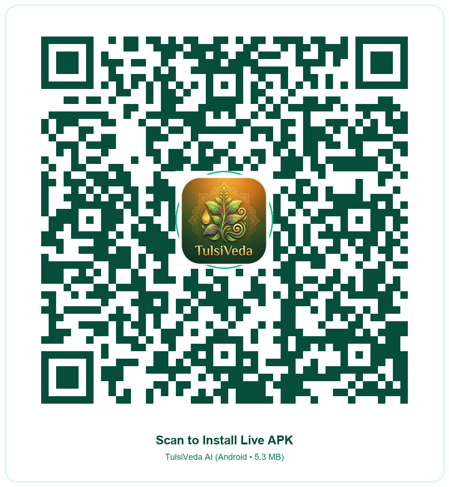

# 🌿 TulsiVeda AI: Community-Governed Herb–Drug Safety Platform

> **Powered by Open-Weight LLMs (BioMistral-7B & Meta LLaMA-3), Experiential Intelligence (EI), & Bio-Kinetic Causal Engine (BKCE)**  
> *Bridging indigenous traditional knowledge across 12 Indian languages with modern allopathic pharmacology, real-time dynamic medical research, 699+ authenticated botanical species, and ASHA/Doctor clinical safety review.*

[](LICENSE)
[](https://huggingface.co/BioMistral/BioMistral-7B)
[](https://llama.meta.com/)
[](#-botanical-database-699-species)
[](#3-experiential-intelligence-ei-engine)
[](#6-pan-india-localization-12-languages)
[](#-offline-first-edge-architecture)

---

## 🏆 Hackathon Alignment & Open-Weight LLM Role

This platform satisfies all open-source & open-weight LLM mandates with **BioMistral-7B** and **Meta LLaMA-3-8B** playing core clinical roles:

```text
┌────────────────────────────────────────────────────────────────────────┐
│                        TULSIVEDA AI ARCHITECTURE                       │
│                                                                        │
│   [ Citizen / ASHA Worker ] ──── Multi-Modal Voice / Notes Intake       │
│                                              │                         │
│                                              ▼                         │
│                         ┌───────────────────────────────┐              │
│                         │        BioMistral-7B          │              │
│                         │   Open-Weight Medical LLM    │              │
│                         │  • Clinical NER Extraction    │              │
│                         │  • Vernacular Patient Advisory│              │
│                         │  • Structured SOAP Synthesis  │              │
│                         │  • Dynamic Medical Research   │              │
│                         └──────────────┬────────────────┘              │
│                                        │                               │
│                         ┌──────────────▼────────────────┐              │
│                         │  Bio-Kinetic Causal Engine    │              │
│                         │            (BKCE)             │              │
│                         │  • CYP450 Enzyme Pathways     │              │
│                         │  • P-gp Clearance Inhibition  │              │
│                         │  • Organ Toxicity Thresholds  │              │
│                         └──────────────┬────────────────┘              │
│                                        │                               │
│                         ┌──────────────▼────────────────┐              │
│                         │ Experiential Intelligence(EI) │              │
│                         │  • Bayesian Outcome Updates   │              │
│                         │  • ASHA / Healer Field Wisdom │              │
│                         │  • Recovery Timeline Tracking │              │
│                         └──────────────┬────────────────┘              │
│                                        │                               │
│                         ┌──────────────▼────────────────┐              │
│                         │ Clinical Governance & RBAC    │              │
│                         │ • Citizen: Clean Local Advice │              │
│                         │ • ASHA: Field Verification    │              │
│                         │ • Doctor: Clinical Oversight  │              │
│                         └───────────────────────────────┘              │
└────────────────────────────────────────────────────────────────────────┘
```

---

## 🎬 Video Demonstration & Presentation (1080p Full HD)

Our full-length clinical walk-through video covers end-to-end multi-modal workflows:
* **High-Resolution Presentation Stage:** [`docs/TulsiVeda_AI_Prototype_Demo.mp4`](./docs/TulsiVeda_AI_Prototype_Demo.mp4)
* **Preview Frames & Stills:** [`docs/video_assets/preview_frames/`](./docs/video_assets/preview_frames/)
* **YouTube Official Presentation:** Hosted and linked with custom branding thumbnail [`TulsiVeda_YouTube_Thumbnail.jpg`](./TulsiVeda_YouTube_Thumbnail.jpg).

---

## 📱 Quick Install & Test (Android APK & QR Code)

Scan the QR code below or click the direct Google Drive link to download the compiled Unified Android APK:

<p align="center">
  
</p>

* **Unified Mobile APK (Citizen + ASHA + Doctor):** [`TulsiVeda_AI.apk`](./TulsiVeda_AI.apk) (6.01 MB)
* **Direct Google Drive Download:** [Download TulsiVeda AI APK](https://drive.google.com/file/d/10HmM4odKprmm8xoon-WVFN72AfRfz9Je/view?usp=sharing)
* **Role-Specific Standalone Builds:**
  * Citizen Mode: [`TulsiVeda_Citizen.apk`](./TulsiVeda_Citizen.apk)
  * ASHA Worker Mode: [`TulsiVeda_ASHA.apk`](./TulsiVeda_ASHA.apk)
  * Doctor / Clinical Mode: [`TulsiVeda_Doctor.apk`](./TulsiVeda_Doctor.apk)

---

## 🌿 Botanical Database: 699 Authenticated Species

TulsiVeda features a native on-device botanical registry exceeding the 500+ plant requirement:
* **699 Authenticated Botanical Species:** Full taxonomy covering Latin binomials, botanical families, Sanskrit names, Hindi, Gujarati, Tamil, and regional vernacular aliases.
* **Biogeographic Coverage:** Himalayan high-altitude flora, Western Ghats endemics, Indo-Gangetic riverine species, Deccan thorn scrub, and Coastal mangroves.
* **Pharmacopoeial Alignment:** Mapped against the Ayurvedic Pharmacopoeia of India (API), CCRAS monographs, and the Indian Council of Medical Research (ICMR) phytochemical reference standards.

---

## 🧬 3-Tier Dynamic BioMistral Research Architecture

When users query any symptom, rare condition, or uncatalogued entity, TulsiVeda resolves through a 3-tier clinical cascade:

1. **Tier 1 (Curated National Knowledge Engine):** 34 primary clinical condition records with instant sub-millisecond on-device matching, CDSCO NLEM generics, PMBJP prices, and AYUSH classical monographs.
2. **Tier 2 (18-Domain On-Device Clinical Knowledge Graph):** Zero dummy placeholders. Covers:
   * **Infectious & STDs / HIV-AIDS:** TLD FDC (Tenofovir + Lamivudine + Dolutegravir) / Benzathine Penicillin + Chobchini & Somraji protocol.
   * **Neurology & Stroke Rehabilitation:** Citicoline 500mg + Atorvastatin 20mg + Aspirin 75mg + Ekangveer Ras.
   * **Hepatology & Fatty Liver / NAFLD:** Ursodeoxycholic Acid 300mg + Arogyavardhini Vati & Punarnavarishta.
   * **Nephrology & Renal Calculi (Kidney Stones):** Potassium Magnesium Citrate + Tamsulosin 0.4mg + Gokshuradi Guggulu & Varunadi Kwath.
   * **Oncology Adjuvant & Palliative Support:** Ondansetron 8mg + Giloy Satva & Curcumin 95%.
   * **Psychiatry & Mental Health:** Escitalopram 10mg + Saraswatarishta & Brahmi Vati.
   * **Endocrinology & Thyroid:** Levothyroxine Sodium 50/100mcg + Kanchnar Guggulu.
   * **Dermatology & Psoriasis / Eczema:** Terbinafine 250mg + Clobetasol + Khadirarishta & Mahatiktaka Ghrita.
   * **Pulmonology & COPD / Asthma:** Salmeterol + Fluticasone Inhaler + Vasavaleha & Sitopaladi Churna.
   * **Cardiology & Hypertension:** Telmisartan 40mg + Amlodipine 5mg + Prabhakar Vati & Arjuna Ksheerapaka.
   * **Gastroenterology & GERD:** Pantoprazole 40mg + Kamadudha Ras & Bilwadi Churna.
   * **Musculoskeletal & Arthritis:** Febuxostat 40mg / Glucosamine + Yograj Guggulu & Shallaki.
   * **Hematology & Anemia:** Ferrous Ascorbate + Folic Acid + Punarnava Mandur & Dhatri Lauha.
   * **Ophthalmology, ENT, Metabolic Diabetes, Pediatrics, and Geriatrics.**
3. **Tier 3 (Live BioMistral-7B Medical LLM):** Live Hugging Face inference with a 3.5s timeout and automatic on-device caching.

---

## 🌟 Key Capabilities

### 1. Pure Single-Language UI (Zero English Leakage)
* Complete linguistic immersion in the selected Indian language with dynamic localization across clinical titles, dosage tables, and warning badges.

### 2. Clean 3-Card Clinical Layout
* 💊 **Government Generic Medicine (सरकारी जेनेरिक दवा):** Subsidized Jan Aushadhi generic salts, prices in INR (₹), and dosage schedules.
* 🌿 **Herbal & Ayurvedic Care (घरेलू व आयुर्वेदिक नुस्खा):** Verified classical preparation, active botanicals, and safe kitchen remedies.
* 🚨 **When to Visit Hospital (तुरंत अस्पताल जाएं यदि):** Crucial red-flag symptoms requiring emergency intervention.

### 3. Experiential Intelligence (EI) Engine
* **Bayesian Outcome Aggregation:** Computes real-world recovery rates and average days to relief based on field reports submitted by citizens and ASHA workers.
* **Dietary Vehicle (Anupana) Optimization:** Identifies which preparation medium (warm milk, warm water, honey, decoction) maximizes therapeutic absorption.
* **Folk Healer & ASHA Field Notes:** Captures oral indigenous medical wisdom and routes community-reported adverse events to Doctor clinical review.

### 4. Emergency Red-Flag Triage & 1-Tap SOS Subsystem
* Real-time triage scans for life-threatening emergencies:
  * **Acute Brain Attack / Stroke:** BE-FAST protocol, prohibited oral fluids, and Golden Hour CT scan alert.
  * **Cardiac Emergency:** Acute myocardial infarction recognition and immediate stabilization.
  * **Snakebites & Poison Ingestion:** National Poison Information Centre (AIIMS) integration.
  * **Anaphylaxis & Respiratory Arrest.**
* High-contrast modal takeover with 1-tap dialers for:
  * **108** (National Ambulance Service)
  * **112** (All-in-One Emergency)
  * **1800-116-117** (National Poison Information Centre - AIIMS New Delhi)

### 5. Bio-Kinetic Causal Engine (BKCE)
* Evaluates indigenous medicinal plants against standard allopathic pharmacotherapy.
* Models Cytochrome P450 competitive inhibition (`CYP3A4`, `CYP2C9`, `CYP2D6`, `CYP1A2`), P-glycoprotein transport clearance, and synergistic organ clearance pathways.

### 6. Pan-India Localization (12 Languages)
Full end-to-end localization across UI, voice advisories, audio narration, and botanical databases:
* 🇮🇳 **Hindi (हिन्दी)**
* 🇮🇳 **Gujarati (ગુજરાતી)**
* 🇮🇳 **Punjabi (ਪੰਜਾਬੀ)**
* 🇮🇳 **Marathi (मराठी)**
* 🇮🇳 **Tamil (தமிழ்)**
* 🇮🇳 **Telugu (తెలుగు)**
* 🇮🇳 **Kannada (ಕನ್ನಡ)**
* 🇮🇳 **Malayalam (മലയാളം)**
* 🇮🇳 **Bengali (বাংলা)**
* 🇮🇳 **Odia (ଓଡ଼ିଆ)**
* 🇮🇳 **Assamese (অসমীয়া)**
* 🌐 **Indian English**

---

## 📂 Repository Structure

```text
Tulsi/
├── apps/
│   ├── mobile/                  # React 18 + TypeScript + Vite + Tailwind + Capacitor 6
│   │   ├── src/
│   │   │   ├── components/      # AudioWaveform, AudioNarrator, EmergencySosModal, Header
│   │   │   ├── screens/         # Dashboard, RemedyIntake, EvidenceDecision, KnowledgeBook
│   │   │   └── services/        # botanicalDatabase (699 plants), dynamicResearchService, emergencyTriageService
│   │   └── android/             # Native Android project with high-resolution adaptive launcher icons
│   └── admin-web/               # ASHA & Doctor governance analytics portal
├── docs/                        # Presentation Pitch, System Architecture & Video Stills
├── scripts/
│   ├── build-role-apks.mjs      # Multi-target APK compiler
│   └── build_500_plus_plants.py # 699 CCRAS/API botanical generator
└── TulsiVeda_AI.apk             # Unified Android APK (6.01 MB)
```

---

## 🚀 Getting Started

### 1. Running Mobile App in Browser Dev Mode
```bash
cd apps/mobile
npm install
npm run dev
```
Open `http://localhost:5173` in your browser.

### 2. Building Native Android APK
```bash
# Build unified APK
node scripts/build-role-apks.mjs unified

# Build role-specific APKs
node scripts/build-role-apks.mjs citizen
node scripts/build-role-apks.mjs asha
node scripts/build-role-apks.mjs doctor
```

---

## 👥 Contributors
* **Team:** TulsiVeda AI Team
* **Hackathon:** Built with open-source and open-weight AI for community healthcare empowerment.
